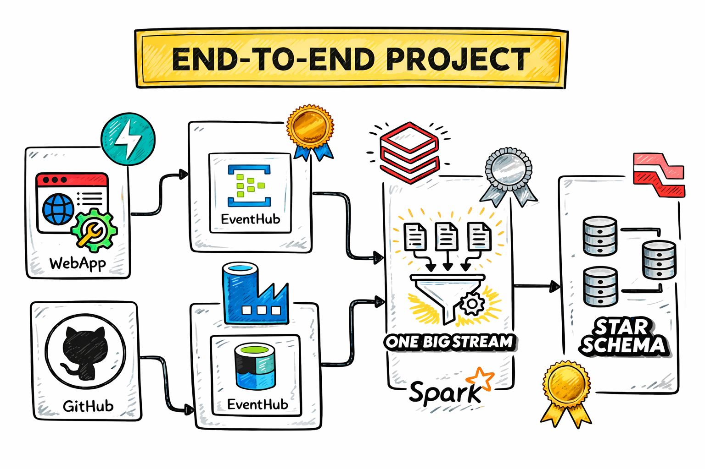
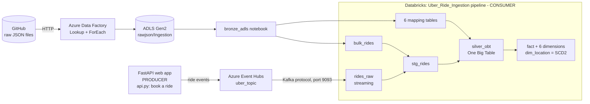
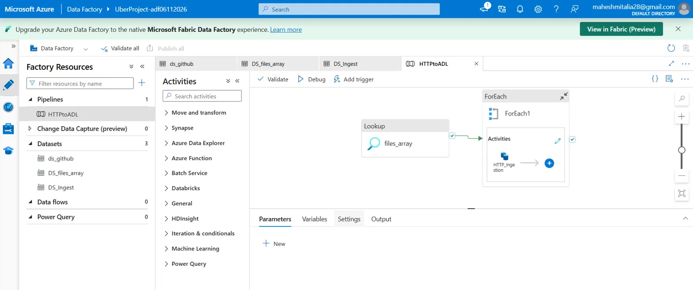
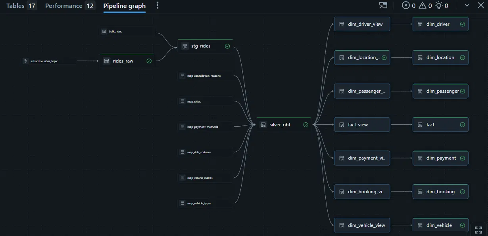
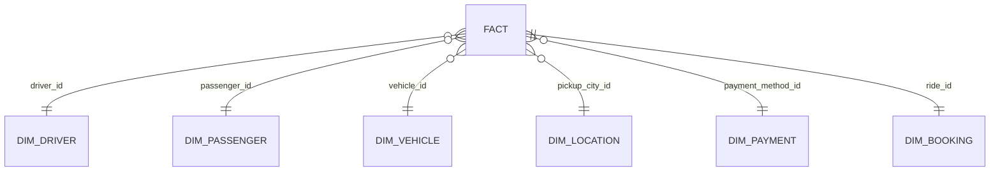

# Uber Ride Data Engineering Pipeline


An end-to-end data engineering project that combines **batch** and **streaming** ingestion of ride-booking data on Azure and Databricks. A **FastAPI web app** acts as the streaming **producer**: every ride booked in the browser is published to Azure Event Hubs. **Databricks** is the **consumer**: a **Spark Declarative Pipeline (SDP)** reads the stream, merges it with historical data landed by Azure Data Factory, builds a **One Big Table (OBT)** with a **Jinja2-generated, metadata-driven** SQL model, and publishes a **star schema** that tracks history with **SCD Type 2** on `dim_location`.



---

## Table of Contents

- [Project Overview](#project-overview)
- [Key Concepts and Terminology](#key-concepts-and-terminology)
- [Architecture](#architecture)
- [Tech Stack](#tech-stack)
- [Data Sources](#data-sources)
- [Pipeline Walkthrough](#pipeline-walkthrough)
  - [1. Batch ingestion with Azure Data Factory](#1-batch-ingestion-with-azure-data-factory)
  - [2. Streaming ingestion: producer web app and Event Hubs](#2-streaming-ingestion-producer-web-app-and-event-hubs)
  - [3. Databricks Spark Declarative Pipeline: bronze, silver, gold](#3-databricks-spark-declarative-pipeline-bronze-silver-gold)
- [Metadata-Driven OBT with Jinja2](#metadata-driven-obt-with-jinja2)
- [Data Model](#data-model)
- [Slowly Changing Dimension Type 2 (dim_location)](#slowly-changing-dimension-type-2-dim_location)
- [How to Run](#how-to-run)
- [Security Notes](#security-notes)
- [Cost and Cleanup](#cost-and-cleanup)
- [Documentation and References](#documentation-and-references)

---

## Project Overview

Ride-hailing platforms generate two kinds of data: large historical extracts and a continuous stream of new bookings. Analysts need both in one consistent, trustworthy model. This project builds that foundation:

- **Batch path:** a metadata-driven Azure Data Factory pipeline copies a list of JSON files over HTTP into ADLS Gen2, and a Databricks notebook loads them into Delta bronze tables.
- **Streaming path (producer):** a FastAPI web app generates a ride booking on each click and publishes it to an Azure Event Hubs topic.
- **Streaming path (consumer):** Databricks reads the topic through the Event Hubs Kafka-compatible endpoint with Structured Streaming.
- **Transformation:** one Spark Declarative Pipeline unifies both sources, joins six reference tables into a One Big Table, and publishes a fact table plus six dimensions.

**What the project demonstrates**

- Orchestrating ingestion with Azure Data Factory (Lookup, ForEach, parameterised datasets)
- Producer-consumer streaming design with Azure Event Hubs and Databricks
- Combining batch and streaming sources into one stream with append flows
- Declarative pipeline development (SDP) with PySpark and SQL
- Generating SQL from metadata with Jinja2, in the spirit of dbt-style templating
- Dimensional modelling with SCD Type 1 and SCD Type 2 using AUTO CDC
- Governing tables with Unity Catalog and Delta Lake

---

## Key Concepts and Terminology

| Term | Meaning in this project |
|---|---|
| **Producer** | The FastAPI web app (`ingestion/api.py`). A user opens the page and books a ride; the app generates a synthetic ride record and sends it to Event Hubs. |
| **Consumer** | The Databricks pipeline. It subscribes to the `uber_topic` event hub and processes events as a stream. |
| **SDP (Spark Declarative Pipelines)** | A framework where you declare datasets (tables, views, flows) and the engine handles dependencies, orchestration and incremental processing. Written with `from pyspark import pipelines as dp`. |
| **Medallion architecture** | Layered data design: **bronze** (raw), **silver** (cleaned and joined), **gold** (analytics-ready star schema). |
| **OBT (One Big Table)** | `silver_obt`: a wide table that joins every ride with all reference data (vehicle make and type, ride status, payment method, city, cancellation reason). Gold tables are carved out of it. |
| **Metadata-driven pipeline** | The OBT SQL is not hand-written. A Jinja2 template renders it from a small configuration list, so adding a join means adding one config entry. |
| **SCD Type 1** | Overwrite changed attributes in place; no history. Used for most dimensions. |
| **SCD Type 2** | Keep every version of a record with validity dates. Used for `dim_location`. |
| **AUTO CDC** | The `create_auto_cdc_flow` API that maintains dimension tables (Type 1 or Type 2) from a stream of changes. |
| **Watermark** | A streaming setting that bounds how late data may arrive; here, 3 minutes on `booking_timestamp`. |

---

## Architecture



---

## Tech Stack

| Layer | Technology | Role |
|---|---|---|
| Producer | FastAPI, Uvicorn, Faker, Jinja2 templates | Web app that generates and publishes ride bookings |
| Streaming | Azure Event Hubs (`azure-eventhub` SDK) | Event topic `uber_topic` with send/listen access policies |
| Orchestration | Azure Data Factory | HTTP-to-ADLS batch ingestion (Lookup + ForEach) |
| Storage | Azure Data Lake Storage Gen2 | Raw JSON landing zone (`rawjson` container) |
| Processing | Databricks: Spark Declarative Pipelines (PySpark, SQL) | Bronze, silver and gold layers |
| Templating | Jinja2 | Generates the OBT SQL from metadata |
| Governance | Unity Catalog, Delta Lake | Catalog `uber`, managed tables and volumes |
| Tooling | uv, Git/GitHub | Dependency management, version control |

---

## Data Sources

**Batch (via Azure Data Factory, stored in `rawjson/Ingestion`)**

| File | Purpose |
|---|---|
| `bulk_rides.json` | Historical ride records (~3 MB) |
| `map_cities.json` | City reference data |
| `map_vehicle_makes.json` | Vehicle make reference data |
| `map_vehicle_types.json` | Vehicle type reference data (rates per mile and minute) |
| `map_payment_methods.json` | Payment method reference data |
| `map_ride_statuses.json` | Ride status reference data |
| `map_cancellation_reasons.json` | Cancellation reason reference data |

The list of files to ingest is defined in `files_array.json`, which keeps the pipeline metadata-driven: adding a file to the list is enough to ingest it, with no pipeline change.

**Streaming (via Azure Event Hubs)**

Ride events are JSON messages with 43 fields (ride, passenger, driver, vehicle, locations, timestamps, fare components, tip, total fare, rating). They are generated with Faker by `ingestion/data.py`, so no real personal data is involved.

---

## Pipeline Walkthrough

### 1. Batch ingestion with Azure Data Factory

The `HTTPtoADL` pipeline has two activities:

1. **Lookup (`files_array`)** reads `files_array.json` from the `rawjson` container.
2. **ForEach (`ForEach1`)** iterates over the returned list and runs a copy activity (`HTTP_Ingestion`) for each file.

Three datasets keep this reusable:

| Dataset | Linked service | Description |
|---|---|---|
| `ds_github` | HTTP (`raw.githubusercontent.com`) | Source JSON files |
| `DS_files_array` | ADLS Gen2 | `rawjson/files_array.json`, the list of files |
| `DS_Ingest` | ADLS Gen2 | `rawjson/Ingestion/@{dataset().p_file}.json`, parameterised sink |



Once the files are in ADLS, the **`bronze_adls` notebook** loads them into Delta tables in Unity Catalog:

- The six `map_*` reference files are written to `uber.bronze.*` with `overwrite` and `overwriteSchema`.
- `bulk_rides` is a one-time initial load, guarded by `spark.catalog.tableExists`, so re-running the notebook never overwrites it.

### 2. Streaming ingestion: producer web app and Event Hubs

**Producer (`ingestion/`)**

| File | Role |
|---|---|
| `api.py` | FastAPI app. `GET /` serves the booking page; `GET /book` generates a ride, publishes it and shows a confirmation page. |
| `data.py` | Generates a realistic ride record with Faker (fares, surge multiplier, tip, coordinates, timestamps) using the reference mappings. |
| `connection.py` | Sends the record to Event Hubs with `EventHubProducerClient`. Reads `CONNECTION_STRING` and `EVENT_HUBNAME` from a `.env` file. |
| `templates/` | `home.html` and `confirmation.html` pages. |

**Consumer (`Databricks_Code_Files/ingest.py`)**

Databricks subscribes to the topic through the Event Hubs **Kafka-compatible endpoint** (`<namespace>.servicebus.windows.net:9093`, `SASL_SSL`, `PLAIN`, username `$ConnectionString`). Key options: `startingOffsets = earliest`, `maxOffsetsPerTrigger = 10000`, `failOnDataLoss = true`. The Kafka `value` is cast to a string and stored in the `rides_raw` streaming table.

### 3. Databricks Spark Declarative Pipeline: bronze, silver, gold

The `Uber_Ride_Ingestion` pipeline is defined by four files in `Databricks_Code_Files/`:

| File | Layer | What it does |
|---|---|---|
| `ingest.py` | Bronze | `rides_raw` streaming table fed from `uber_topic` |
| `silver.py` | Silver (staging) | Creates the empty streaming table `stg_rides` and fills it from **two append flows**: `rides_bulk` (from `bulk_rides`) and `rides_stream` (parses `rides_raw` JSON with an explicit schema using `from_json`) |
| `silver_obt.sql` | Silver (OBT) | `silver_obt` streaming table: `stg_rides` with a 3-minute watermark on `booking_timestamp`, left-joined to the six reference tables |
| `model.py` | Gold | Six dimensions and the fact table, maintained with `create_auto_cdc_flow` |

The pipeline contains 17 datasets: 11 streaming tables and 6 views. The reference tables and `bulk_rides` are loaded by the `bronze_adls` notebook and read by the pipeline as inputs.

| Layer | Datasets | Description |
|---|---|---|
| **Bronze** | `rides_raw`, `bulk_rides`, six `map_*` tables | Raw stream and raw files |
| **Staging** | `stg_rides` | Unifies the bulk load and the stream into one table |
| **Silver** | `silver_obt` | One Big Table: rides enriched with all reference data |
| **Gold** | `fact`, `dim_driver`, `dim_passenger`, `dim_vehicle`, `dim_location`, `dim_payment`, `dim_booking` | Star schema built from `silver_obt` |

Each gold table is fed by a view over `silver_obt` (`fact_view`, `dim_*_view`) that deduplicates on the business key, then published with AUTO CDC. For `dim_location` the intermediate dataset is a table rather than a view.



---

## Metadata-Driven OBT with Jinja2

Writing a seven-table join by hand is repetitive and error-prone, so the OBT query is **generated**. In the `silver_obt` notebook:

1. A **configuration list** describes every table in the join: its name, the columns to select, an optional filter, and the join condition.
2. A **Jinja2 template** loops over that list and renders a complete `SELECT ... FROM ... LEFT JOIN ...` statement.
3. The rendered SQL is saved as `silver_obt.sql` and deployed as a streaming table in the pipeline.

```python
jinja_config = [
    {"table": "uber.bronze.stg_rides stg_rides", "select": "stg_rides.ride_id, ...", "where": ""},
    {"table": "uber.bronze.map_vehicle_makes map_vehicle_makes",
     "select": "map_vehicle_makes.vehicle_make", "where": "",
     "on": "stg_rides.vehicle_make_id = map_vehicle_makes.vehicle_make_id"},
    # ... one entry per reference table
]
```

Adding another reference table, column or filter means editing the configuration, not the SQL. This is the same idea dbt applies (templated SQL driven by configuration), implemented here as a small custom layer.

---

## Data Model

The gold layer is a star schema: one fact table of rides surrounded by six dimensions.



| Table | Business key | Key attributes | History |
|---|---|---|---|
| `fact` | `ride_id` plus the five foreign keys | `distance_miles`, `duration_minutes`, `base_fare`, `distance_fare`, `time_fare`, `surge_multiplier`, `total_fare`, `tip_amount`, `rating`, `base_rate`, `per_mile`, `per_minute` | SCD Type 1 |
| `dim_passenger` | `passenger_id` | name, email, phone | SCD Type 1 |
| `dim_driver` | `driver_id` | name, rating, phone, license | SCD Type 1 |
| `dim_vehicle` | `vehicle_id` | make, type, model, color, license plate | SCD Type 1 |
| `dim_payment` | `payment_method_id` | payment method, is_card, requires_auth | SCD Type 1 |
| `dim_booking` | `ride_id` | confirmation number, pickup and dropoff address, coordinates, timestamps, status, cancellation reason | SCD Type 1 |
| `dim_location` | `pickup_city_id` | city, state, region | **SCD Type 2** |

---

## Slowly Changing Dimension Type 2 (dim_location)

City attributes such as region or state can change over time, and past rides should still point to the attributes that were valid at the time. `dim_location` therefore keeps history:

```python
dp.create_streaming_table("dim_location")
dp.create_auto_cdc_flow(
    target = "dim_location",
    source = "dim_location_view",
    keys = ["pickup_city_id"],
    sequence_by = "city_updated_at",   # ordering of versions
    stored_as_scd_type = 2,
)
```

- `sequence_by = city_updated_at` (the `updated_at` column of `map_cities`) orders the versions of each city.
- A changed city produces a **new row**; the previous row is closed.
- The pipeline maintains the validity columns `__START_AT` and `__END_AT`. The current version of a city has `__END_AT IS NULL`.

Query the current version when joining to the fact table:

```sql
SELECT fact.ride_id, fact.base_fare, dim.region
FROM uber.bronze.fact AS fact
LEFT JOIN uber.bronze.dim_location AS dim
  ON  fact.pickup_city_id = dim.pickup_city_id
  AND dim.`__END_AT` IS NULL;
```

The other five dimensions and the fact table use **SCD Type 1**: updates overwrite the existing row.

---

## How to Run

### Prerequisites

- An Azure subscription (free tier is enough)
- A Databricks workspace (Free Edition works) with Unity Catalog
- Python 3.12 (see `.python-version`) and [uv](https://docs.astral.sh/uv/) or pip

### 1. Clone and install

```bash
git clone https://github.com/mpmitalia/Uber_data_Engineering_Project.git
cd Uber_data_Engineering_Project

# with uv
uv sync
# or with pip
pip install -r requirements.txt
```

### 2. Provision Azure resources

Create one resource group containing:

- A **Storage account** with hierarchical namespace enabled (ADLS Gen2) and a container named `rawjson`
- An **Event Hubs namespace** with an event hub named `uber_topic`, plus two shared access policies: one with **Send**, one with **Listen**
- An **Azure Data Factory** instance

### 3. Run the batch ingestion

1. Upload `files_array.json` to the `rawjson` container.
2. In Data Factory, create the linked services (HTTP and ADLS Gen2), the three datasets and the `HTTPtoADL` pipeline described above.
3. Run the pipeline. The seven JSON files appear in `rawjson/Ingestion`.
4. In Databricks, run the `bronze_adls` notebook to load the files into `uber.bronze` (provide a read-only SAS token for the storage account when prompted in the notebook; never commit it).

### 4. Start the producer web app

Create a `.env` file (it is git-ignored) with the **Send** policy connection string:

```
CONNECTION_STRING=<event hubs send-policy connection string>
EVENT_HUBNAME=uber_topic
```

Run the app from the repository root and open <http://localhost:8000>:

```bash
python ingestion/api.py
```

Each click on **Book** sends one ride to Event Hubs. Confirm events arrive using **Data Explorer** on the `uber_topic` event hub.

### 5. Run the Databricks pipeline

1. In Databricks, create the `uber` catalog, a `bronze` schema and a volume.
2. Create a pipeline named `Uber_Ride_Ingestion` and add the files from `Databricks_Code_Files/` as its source code.
3. Set the pipeline configuration key `connection_string` to the Event Hubs **Listen** policy connection string, and set the namespace and event hub names at the top of `ingest.py`.
4. Run the pipeline, book a few rides in the web app, and watch them flow through `rides_raw` → `stg_rides` → `silver_obt` → gold tables in Catalog Explorer.

---

## Security Notes

- Connection strings, storage account keys and SAS tokens are **never committed**; the producer reads them from a git-ignored `.env` file and the pipeline from its configuration.
- Producers use a **Send-only** policy and consumers a **Listen-only** policy.
- All ride, passenger and driver details are synthetic (generated with Faker).

---

## Cost and Cleanup

Azure resources can incur charges while they exist. When finished, delete the whole resource group to remove everything at once:

```bash
az group delete --name uber_project_rg --yes
```

---

## Documentation and References

The code in this repository maps to the following official documentation.

| Area | Where it is used | Documentation |
|---|---|---|
| Event Hubs Kafka endpoint | `ingest.py`: `kafka.bootstrap.servers` on port 9093, `SASL_SSL`, `PLAIN`, username `$ConnectionString` | [Azure Event Hubs for Apache Kafka](https://learn.microsoft.com/en-us/azure/event-hubs/azure-event-hubs-apache-kafka-overview) |
| Event Hubs Python SDK | `connection.py`: `EventHubProducerClient`, `create_batch`, `send_batch` | [Send events to Event Hubs with Python](https://learn.microsoft.com/en-us/azure/event-hubs/get-started-python-send-v2) |
| Data Factory Lookup + ForEach | `HTTPtoADL` pipeline: `@activity('files_array').output.value` feeding ForEach | [Lookup activity](https://learn.microsoft.com/en-us/azure/data-factory/control-flow-lookup-activity) |
| Data Factory HTTP connector | `ds_github` dataset: base URL plus relative URL | [HTTP connector](https://learn.microsoft.com/azure/data-factory/connector-http) |
| Spark Declarative Pipelines (Python) | `ingest.py`, `silver.py`, `model.py`: `@dp.table`, `@dp.view`, `@dp.append_flow`, `create_streaming_table` | [Pipelines Python reference](https://learn.microsoft.com/en-us/azure/databricks/ldp/developer/python-ref) |
| AUTO CDC and SCD | `model.py`: `create_auto_cdc_flow` with `stored_as_scd_type` 1 and 2, `__START_AT` / `__END_AT` | [AUTO CDC APIs](https://docs.databricks.com/aws/en/ldp/cdc) and [create_auto_cdc_flow](https://docs.databricks.com/aws/en/dlt-ref/dlt-python-ref-apply-changes) |
| Jinja2 templating | `silver_obt` notebook: generates the OBT SQL | [Jinja documentation](https://jinja.palletsprojects.com/) |
| FastAPI | `api.py`: routes and Jinja2 templates | [FastAPI documentation](https://fastapi.tiangolo.com/) |
| Faker | `data.py`: synthetic ride data | [Faker documentation](https://faker.readthedocs.io/) |
