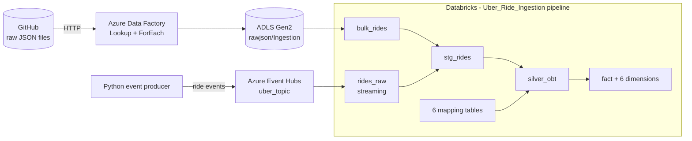
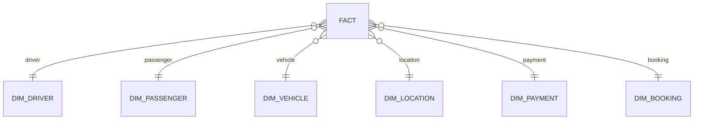

# Uber Ride Data Engineering Pipeline


An end-to-end data engineering project that combines **batch** and **streaming** ingestion of ride-booking data on Azure and Databricks. Raw JSON is landed in Azure Data Lake Storage Gen2 by an Azure Data Factory pipeline, live ride events are streamed through Azure Event Hubs, and a Databricks pipeline turns both into a **medallion architecture** (bronze → silver → gold) that ends in a **star schema** ready for analytics.


---

## Table of Contents

- [Project Overview](#project-overview)
- [Architecture](#architecture)
- [Tech Stack](#tech-stack)
- [Data Sources](#data-sources)
- [Pipeline Walkthrough](#pipeline-walkthrough)
  - [1. Batch ingestion with Azure Data Factory](#1-batch-ingestion-with-azure-data-factory)
  - [2. Streaming ingestion with Azure Event Hubs](#2-streaming-ingestion-with-azure-event-hubs)
  - [3. Databricks pipeline: bronze, silver, gold](#3-databricks-pipeline-bronze-silver-gold)
- [Data Model](#data-model)
- [Repository Structure](#repository-structure)
- [How to Run](#how-to-run)
- [Security Notes](#security-notes)
- [Cost and Cleanup](#cost-and-cleanup)
- [Future Improvements](#future-improvements)
- [Author](#author)

---

## Project Overview

Ride-hailing platforms generate two kinds of data: large historical extracts and a continuous stream of new bookings. Analysts need both in one consistent, trustworthy model. This project builds that foundation:

- **Batch path:** a metadata-driven Azure Data Factory pipeline copies a list of JSON files over HTTP into ADLS Gen2.
- **Streaming path:** ride events are published to an Azure Event Hubs topic and consumed by Databricks.
- **Transformation:** a single Databricks pipeline unifies both sources, enriches rides with six reference (mapping) tables, and publishes a fact table and six dimension tables.

**What the project demonstrates**

- Orchestrating ingestion with Azure Data Factory (Lookup, ForEach, parameterised datasets)
- Landing raw data in ADLS Gen2 and governing tables with Unity Catalog
- Combining batch and streaming sources in one pipeline
- Medallion architecture and dimensional (star schema) modelling
- Declarative pipeline development in Databricks with PySpark and SQL

---

## Architecture



---

## Tech Stack

| Layer | Technology | Role |
|---|---|---|
| Orchestration | Azure Data Factory | HTTP-to-ADLS batch ingestion (Lookup + ForEach) |
| Storage | Azure Data Lake Storage Gen2 | Raw JSON landing zone (`rawjson` container) |
| Streaming | Azure Event Hubs | Ride event topic (`uber_topic`) with send/listen access policies |
| Processing | Databricks (PySpark, SQL) | Declarative pipeline for bronze, silver and gold layers |
| Governance | Unity Catalog, Delta Lake | Catalog `uber`, managed tables and volumes |
| Language | Python | Event producer, pipeline transformations |
| Tooling | uv, Git/GitHub | Dependency management, version control |

---

## Data Sources

**Batch (via Azure Data Factory, stored in `rawjson/Ingestion`)**

| File | Purpose |
|---|---|
| `bulk_rides.json` | Historical ride records (~3 MB) |
| `map_cities.json` | City reference data |
| `map_vehicle_makes.json` | Vehicle make reference data |
| `map_vehicle_types.json` | Vehicle type reference data |
| `map_payment_methods.json` | Payment method reference data |
| `map_ride_statuses.json` | Ride status reference data |
| `map_cancellation_reasons.json` | Cancellation reason reference data |

The list of files to ingest is defined in `files_array.json`, which keeps the pipeline metadata-driven: adding a file to the list is enough to ingest it, with no pipeline change.

**Streaming (via Azure Event Hubs)**

Ride events are published as JSON messages (each carrying a `ride_id`) to the `uber_topic` event hub in the `uber-events` namespace.

---

## Pipeline Walkthrough

### 1. Batch ingestion with Azure Data Factory

The `HTTPtoADL` pipeline has two activities:

1. **Lookup (`files_array`)** reads `files_array.json` from the `rawjson` container.
2. **ForEach (`ForEach1`)** iterates over the returned list and runs a copy activity (`HTTP_Ingestion`) for each file.

Three datasets keep this reusable:

| Dataset | Linked service | Description |
|---|---|---|
| `ds_github` | HTTP (`raw.githubusercontent.com`) | Source JSON files |
| `DS_files_array` | ADLS Gen2 | `rawjson/files_array.json`, the list of files |
| `DS_Ingest` | ADLS Gen2 | `rawjson/Ingestion/@{dataset().p_file}.json`, parameterised sink |


### 2. Streaming ingestion with Azure Event Hubs

Ride events are sent to the `uber_topic` event hub using a dedicated **send** policy. Databricks consumes them with a separate **listen** policy, following least-privilege access.


### 3. Databricks pipeline: bronze, silver, gold

The `Uber_Ride_Ingestion` pipeline contains the transformation code (`ingest.py`, `silver.py`, `model.py`, `silver_obt.sql`) and exploration notebooks (`bronze_adls`, `silver_obt`). It produces 17 tables:

| Layer | Tables | Description |
|---|---|---|
| **Bronze** | `rides_raw`, `bulk_rides` | `rides_raw` is the streaming table fed from `uber_topic`; `bulk_rides` holds the batch data landed by ADF |
| **Staging** | `stg_rides` | Unifies streaming and batch rides into one dataset |
| **Reference** | `map_cities`, `map_vehicle_makes`, `map_vehicle_types`, `map_payment_methods`, `map_ride_statuses`, `map_cancellation_reasons` | Lookup tables loaded from the mapping files |
| **Silver** | `silver_obt` | One Big Table: rides joined with all reference tables |
| **Gold** | `fact`, `dim_driver`, `dim_passenger`, `dim_vehicle`, `dim_location`, `dim_payment`, `dim_booking` | Star schema built from `silver_obt` |

Each gold table is defined through a view over `silver_obt` (`fact_view`, `dim_*_view`) and published as a table.


---

## Data Model

The gold layer is a star schema: one fact table of ride events surrounded by six dimensions.



<!-- Optional: replace the diagram above with a detailed ERD (docs/data_model.png) that lists columns and keys. -->

---

## Repository Structure

```
Uber_data_Engineering_Project/
├── Code_Files/            # Databricks pipeline code and notebooks
├── Data/                  # Source JSON files (rides and mapping tables)
├── templates/             # Templates used by the event producer
├── api.py                 # Event producer entry point
├── connection.py          # Event Hubs connection helper
├── data.py                # Ride event generation / data helpers
├── files_array.json       # List of files the ADF pipeline ingests
├── architecture.png       # Architecture diagram
├── Uber_Project.svg       # Architecture diagram (vector)
├── pyproject.toml         # Project metadata and dependencies (uv)
├── requirements.txt       # pip-compatible dependency list
├── uv.lock                # Locked dependency versions
├── .python-version
└── README.md
```

---

## How to Run

### Prerequisites

- An Azure subscription (free tier is enough)
- A Databricks workspace (Free Edition works) with Unity Catalog
- Python (see `.python-version`) and [uv](https://docs.astral.sh/uv/) or pip

### 1. Clone and install

```bash
git clone https://github.com/mpmitalia/Uber_data_Engineering_Project.git
cd Uber_data_Engineering_Project

# with uv
uv sync
# or with pip
pip install -r requirements.txt
```

### 2. Provision Azure resources

Create one resource group containing:

- A **Storage account** with hierarchical namespace enabled (ADLS Gen2) and a container named `rawjson`
- An **Event Hubs namespace** with an event hub named `uber_topic`, plus two shared access policies: one with **Send**, one with **Listen**
- An **Azure Data Factory** instance

### 3. Run the batch ingestion

1. Upload `files_array.json` to the `rawjson` container.
2. In Data Factory, create the linked services (HTTP and ADLS Gen2), the three datasets and the `HTTPtoADL` pipeline described above.
3. Run the pipeline. The seven JSON files appear in `rawjson/Ingestion`.

### 4. Start the event producer

Set your Event Hubs connection details as environment variables (never hard-code them), then run the producer:

```bash
python api.py
```

Confirm events arrive using **Data Explorer** on the `uber_topic` event hub.

### 5. Run the Databricks pipeline

1. In Databricks, create the `uber` catalog and a `bronze` schema with a volume.
2. Create a pipeline named `Uber_Ride_Ingestion` and add the files from `Code_Files/` as its source.
3. Configure access to ADLS Gen2 and the Event Hubs listen policy.
4. Run the pipeline and check the resulting tables in Catalog Explorer.

---

## Security Notes

- Connection strings, storage account keys and SAS tokens are **never committed**; they are supplied through environment variables.
- Producers use a **Send-only** policy and consumers a **Listen-only** policy.
- `.gitignore` excludes local environment files.

---

## Cost and Cleanup

Azure resources can incur charges while they exist. When finished, delete the whole resource group to remove everything at once:

```bash
az group delete --name uber_project_rg --yes
```

---

## Future Improvements

- Add data quality expectations to the Databricks pipeline and track pass/fail counts
- Add a dashboard or BI report on the gold layer (revenue, cancellations, peak hours)
- Schedule the pipeline with a Databricks Job
- Add CI checks (linting and tests) with GitHub Actions
- Provision Azure resources with Terraform or Bicep for one-command setup

---

## Author

**Mahesh Mitalia**
Final-year Computer Engineering student, D. J. Sanghvi College of Engineering

[LinkedIn](https://linkedin.com/in/maheshmitalia28) | [GitHub](https://github.com/mpmitalia)
